<!-- ═══════════════════════════════════════════════════════════════
     AVANI.EXE  ·  profile of @avani376
     theme: neon-terminal / holographic  ·  designed in ZCode
     ═══════════════════════════════════════════════════════════════ -->

<div align="center">







</div>

---

### ⬡ identity.sys

<div align="center">

</div>

> ```diff
> + vessel for caffeine · ships TypeScript & Python · teaches machines to read PDFs
> ```

<div align="center">

**◈ currently deploying →** [**`jallekha`**](https://github.com/avani376/jallekha) — water-delivery & consumption
reconciliation for campuses, with a deterministic balance and a full audit trail

</div>

---

### ⌁ skill.matrix

<div align="center">

</div>

<div align="center">

</div>

---

### ▣ the.workstation

<div align="center">

</div>

<div align="center">

*03:00 build runs don't count as insomnia if the tests pass.*

</div>

---

### 📡 telemetry

*Every number below is pulled from the GitHub API by my own renderer and committed
back to this repo — nothing on this page depends on a third-party service.*

<div align="center">



</div>

---

### 🐍 contribution.stream

<div align="center">

<!-- self-rendered: .github/workflows/telemetry.yml → tools/render_telemetry.py -->


</div>

---

### ⇄ uplink

<div align="center">

<a href="https://www.linkedin.com/in/avani-jannawar-2a4307369">
  
</a>

&nbsp;

<a href="https://x.com/a_avani08"></a>
<a href="https://github.com/avani376"></a>

</div>

<details>
<summary><b>🔓 decrypt hidden transmission</b></summary>

```
        ██  ██        the flag is not the point.
        ██  ██        the point is that you scrolled
        ██████        all the way down here.
        ██  ██
        ██  ██        ▸ star something you like:
                      github.com/avani376?tab=repositories
```

</details>

<div align="center">


</div>
